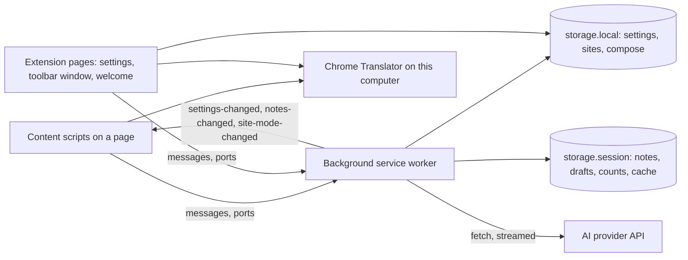
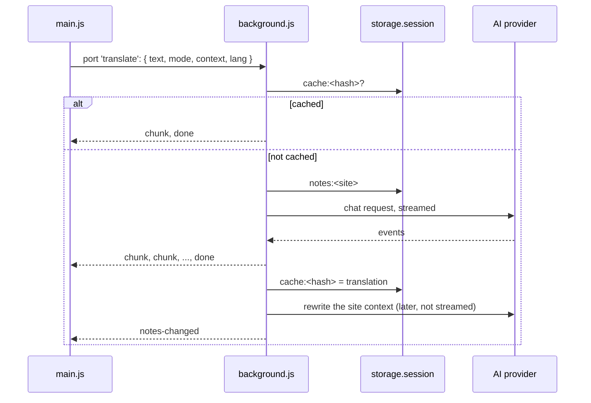

# Architecture

SpotSlate is a Chrome extension (Manifest V3) in plain JavaScript. There is no build step: Chrome loads the files in `extension/` as they are. The design spec, [docs/superpowers/specs/2026-10-12-spotslate-design.md](docs/superpowers/specs/2026-10-12-spotslate-design.md), holds every rule and test scenario. The map below shows where they live and how the parts talk.

The shapes of the data, every message and the storage layout are typed in [types/spotslate.d.ts](types/spotslate.d.ts). Open it next to this page.

## Runtime contexts

| Context | Files | Reads | Talks through |
|---|---|---|---|
| Page | `extension/content/*.js`, classic scripts on every page, top frame only | the page's DOM, never its scripts or the API keys | messages and ports to background |
| Background | `extension/background.js` with the modules in `extension/lib/` | the settings with the keys, the site contexts, the cache | messages to tabs and pages, `fetch` to the AI provider |
| Extension pages | `options.html` (settings), `compose.html` (toolbar window), `welcome.html` (on install), `pdf.html` (the PDF reader) | the settings, through the same `lib/` modules; the reader, a PDF the user opens | messages and ports to background |
| Storage | `chrome.storage.local` and `chrome.storage.session` | | |



Three boundaries shape the code:

- **The keys never reach a page.** Background calls `chrome.storage.local.setAccessLevel({ accessLevel: 'TRUSTED_CONTEXTS' })`, so content scripts cannot read storage. A page gets only `PageSettings`: the language, the engine, the keys to press, the companion.
- **A page cannot drive SpotSlate.** Every handler checks `event.isTrusted`, and the popup, the compose window and the companion live in closed shadow roots (`SHADOW_MODE` in `content/config.js`).
- **Background decides the site.** A content script never names its site; background takes it from the sender's tab (`siteOf`). Extension pages, which are on no site, name the active tab's.

With Chrome's translator (the default provider, `engine: 'browser'`) the page translates by itself and background only remembers languages. With an AI provider (`engine: 'api'`) the page sends the text to background, which calls the API.

## Content scripts

The content scripts are classic scripts, not modules. Each one is a function that runs once and adds what it offers to one shared object, `globalThis.spotslate`. Later scripts take what earlier ones added, so the order matters. It is kept in four places: `content_scripts` in `manifest.json`, `welcome.html` (all of them, checked by `tests/unit/manifest.test.js`), `compose.html` (the composer and what it needs) and `options.html` (Chrome's translator and the companions).

One script stands apart: `content/youtube-timedtext.js` runs in the page's own world (`world: "MAIN"`, `run_at: "document_start"`, matched to `youtube.com`), the only place that sees the player's network. It wraps `XMLHttpRequest`/`fetch` to catch the caption timeline (`/api/timedtext`) and hands it to the isolated-world `youtube.js` by `postMessage` for the subtitle look-ahead. It shares nothing with `globalThis.spotslate` and reads only the public caption data.

In the order Chrome loads them:

| File | Adds | Role |
|---|---|---|
| `config.js` | `SHADOW_MODE` | closed shadow roots; the e2e tests run a copy with open ones |
| `strings.js` | `STRINGS`, `t`, `languageName` | everything SpotSlate says, in 13 languages |
| `block.js` | `inspectBlock`, `elementAt`, `writableField`, ... | the paragraph under the mouse, the field to write in |
| `selection.js` | `selectionAt`, `isShortPhrase`, `contextOf`, ... | the user's selection, a phrase and the words around it |
| `language.js` | `detectLanguage`, `alreadyInLanguage`, ... | Chrome's LanguageDetector, with a memory of the last 100 texts |
| `translator.js` | `translateInBrowser`, `prepareInBrowser`, `describeProblem`, ... | Chrome's Translator: model downloads, problems in words |
| `notes-panel.js` | `createNotesPanel` | the site context panel |
| `lang-picker.js` | `createLanguagePicker` | the language button and list of every title row |
| `markdown.js` | `parseMarkdown` | the learning mode's Markdown breakdown, cut into blocks even half-streamed |
| `popup.js` | `createPopup`, `createGrip`, `splitLesson`, `splitBold` | the translation popup: position, pinning, dragging, resizing |
| `highlight.js` | `createHighlight` | the dashed outline and the line to the popup |
| `correction.js` | `parseCorrection`, `diffWords` | reading a checked text and what changed |
| `composer.js` | `createComposer` | the compose window's content, also in the toolbar window |
| `compose-window.js` | `createComposeWindow` | the compose window on a page: where it opens and closes |
| `pixels.js`, `pup.js`, `cat.js`, `corgi.js` | `pixels`, `heroes` | the companions as pixel data |
| `hero.js` | `createHero`, `drawHero` | the companion by the mouse and on the popup |
| `main.js` | nothing | the page's state and every event handler; ties the rest together |

`main.js` is the entry point and the busiest file: 625 lines, 25 pieces of state, and the handlers for the keys, the mouse, scrolling and messages. Most features start there.

## Background and lib

`background.js` is the router. It answers the messages and ports from pages, keeps the site contexts up to date, and owns the cache. The modules in `lib/` hold the logic it needs, each testable on its own (`tests/unit/`):

| Module | What it knows |
|---|---|
| `settings.js` | the stored settings, checked (`withDefaults`), the provider in use (`activeProvider`), the languages |
| `providers.js` | the provider presets, how to build a request for each API, what to fix before sending (`setupProblem`) |
| `chat.js` | sending a chat request, again without the reasoning options when a model rejects them; reading a stream |
| `sse.js` | parsing server-sent events into text |
| `prompt.js` | the translation prompt, with the site context as a reference turn |
| `notes.js` | the prompt that rewrites a site's context, and cleaning its answer |
| `compose.js` | the compose and correction prompts, and which languages the compose window starts with |
| `errors.js` | errors by code, worded in the user's language |
| `keys.js` | the keys and shortcuts, and which ones are refused |
| `sites.js` | the mode of each site |

The settings page and the welcome page import these modules too. The editor follows them without help, since they use `import`.

## Flow: a paragraph translated

The read key (Alt) is held over a paragraph:

1. `main.js` notes the key on `keydown` and outlines what is under the mouse (`updatePreview`, `highlight.show`).
2. After 200 ms without moving, `trigger()` picks the target: the user's selection (`selectionAt`) or the block (`inspectBlock`). The result is a `Picked`.
3. Chrome's detector checks whether the text is already in the target language, for at most 300 ms (`isAlreadyInTargetLanguage`).
4. `show()` opens the popup on the target, anchors the outline to it and wakes the companion. `load()` takes the page cache or calls `translate()`.
5. With Chrome's translator, `translateHere()` translates on the page. With an AI provider, `translate()` opens the port `translate` and sends a `TranslateRequest`.
6. In background, `translate()` checks the setup and the site's mode, looks in the session cache, builds the prompt with the site context (`buildMessages`) and streams the answer back (`stream`, `sendChat`, `readTextStream`).
7. `main.js` shows each `chunk` with `popup.setText()`, and `done` or `error` ends it.
8. After the answer, background counts the text's language for the site and queues the text and its translation to teach the site context (`learn`, `updateNotes`). When the context changes, `notes-changed` goes to the site's tabs.



## Flow: the compose window

Alt+T, or Alt+click on a field, opens the compose window:

1. `main.js` asks background for `compose-open` and gets a `ComposeState`: the languages, the engine, the site context, the last draft (`composeState`).
2. `createComposeWindow().open()` places the window at the field or by the mouse; `createComposer()` builds its content.
3. While the user types, the composer translates the draft: with Chrome's translator on the page, with an AI provider on the port `compose` with a `ComposeRequest`. `purpose` is `write` (into the page's language), `check` (back into the user's own) or `correct` (the same language on both sides: the user's own writing, corrected).
4. A correction comes back as `<corrected>` and `<notes>`; `parseCorrection` and `diffWords` show what changed.
5. The draft and the languages chosen go to background as they change (`compose-draft`, `compose-source`, `compose-target`), so the next window on the site starts from them.

The toolbar window (`compose.html`, `compose-page.js`) is the same composer on its own page. It first asks the active tab for its declared language and whether it shows a PDF (`compose-context`), then opens the same way, naming the tab's site. On a PDF tab it adds a row that opens the PDF in the reader.

## Flow: the PDF reader

Chrome's PDF viewer has no DOM text, so `pdf.html` renders a PDF with pdf.js (`vendor/pdfjs/`) and loads the content scripts, which then work on it as on any page. `pdf-view.js` opens a picked or dropped file, or the address in `?src=` (from the toolbar window's row; a web address once SpotSlate may read its host, asked with `permissions.request` on a click). Each page draws as it comes near the view (an `IntersectionObserver`) and is dropped once far away. After a page's text layer renders, `paragraphsOf` (`lib/pdf-layout.js`) groups pdf.js's text runs into lines and paragraphs, keeping columns apart, and each paragraph is wrapped in a `data-spotslate-block` element with its text, hyphenated words made whole, in `data-spotslate-text`; `inspectBlock` in `content/block.js` translates that block on Alt.

## Flow: settings changed

- **Settings page.** Save writes `settings` to `storage.local`. Background hears it (`storage.onChanged`) and sends `settings-changed` with the new `PageSettings` to every tab. `main.js` applies it at once: the language, the engine, the keys, the companion.
- **Language in a title bar.** A popup sends `set-target-lang`; background saves it, and the same `settings-changed` follows.
- **Site switches.** The toolbar window sends `set-site-mode`. Background saves the mode, forgets the site's context if the mode needs that, and sends `site-mode-changed` to the site's tabs and to extension pages.

## Messages

All of them are typed in `types/spotslate.d.ts` (`SpotSlate.Message`, `SpotSlate.Broadcast`, the port requests and `SpotSlate.PortAnswer`).

To background, with `chrome.runtime.sendMessage`:

| Message | Sent by | Answer |
|---|---|---|
| `page-settings` | `main.js` on load | `PageSettings` and the site's mode |
| `compose-open` | `main.js`, `compose-page.js` | `ComposeState` |
| `compose-source`, `compose-target`, `compose-draft` | the composer | none; remembered for the site |
| `set-target-lang` | the popup's language list | none; saved in the settings |
| `set-site-mode` | `compose-page.js`, `options.js` (Reset) | the mode as saved |
| `notes`, `clear-notes` | the context panel | the site's context; none |
| `video-context` | `main.js` when captions run | a YouTube video's subtitle context `{ text }`, by id |
| `add-word` | `main.js` on Alt+A | saved to the vocabulary by language; `{ added, word, lang }` |
| `vocabulary`, `remove-word` | the vocabulary view | the whole vocabulary; the vocabulary after a delete |
| `read-lang` | `main.js`, after Chrome's translator | none; counted for the site |
| `report` | the popup's Report | none; opens a GitHub issue |
| `open-options` | the popup's and the composer's gear | none |
| `site-mode` | nothing (see "Loose ends") | the site's mode |

From background or the toolbar window, with `chrome.tabs.sendMessage` or to extension pages:

| Message | Goes to | Means |
|---|---|---|
| `settings-changed` | every tab | new `PageSettings` |
| `site-mode-changed` | the site's tabs, extension pages | a site's new mode |
| `notes-changed` | the site's tabs, extension pages | the site context, or that it is being rewritten |
| `compose-context` | the active tab, from the toolbar window | answered with `{ pageLang, pdf }` (`pdf`: the tab shows a PDF) |

Ports, with `chrome.runtime.connect`, answered with `chunk`, then `done` or `error`:

| Port | Opened by | Request |
|---|---|---|
| `translate` | `main.js` | `TranslateRequest` |
| `compose` | `composer.js` | `ComposeRequest` |

Closing a port cancels the request: background aborts the `fetch`.

## Storage

| Area | Key | Holds | Written by |
|---|---|---|---|
| local | `settings` | `Settings`: provider, keys of every provider, language, keys to press, companion | settings page, welcome page, `set-target-lang` |
| local | `sites` | the sites with a mode of their own | `set-site-mode` |
| local | `compose` | the compose window's languages per site, and the last one | `compose-source`, `compose-target` |
| local | `vocabulary` | words saved with Alt+A, by language | `add-word`, `remove-word` |
| session | `notes:<site>` | the site context | background, after translations |
| session | `vctx:<video id>` | a YouTube video's subtitle context | background, from the video metadata and lines |
| session | `langs:<site>` | how many texts were read there in each language | background |
| session | `draft:<site>` | the last draft written there | `compose-draft` |
| session | `cache:<hash>` | a translation; cleared when the session storage is full | background |

`storage.session` is cleared when the browser closes. The content scripts also keep a small cache of their own per page (100 translations, in `main.js`).

## Index by task

| To change | Look at |
|---|---|
| what counts as a paragraph, a selection, a field | `content/block.js`, `content/selection.js`, `pickUnderMouse` in `main.js` |
| when a translation starts, closes, or is put away | `trigger`, `show`, `closePopup`, `checkLeave` and the handlers at the end of `main.js` |
| the popup's place, size, pinning, dragging | `content/popup.js` |
| the prompts | `lib/prompt.js`, `lib/notes.js`, `lib/compose.js` |
| how the learning breakdown (Markdown) is read and drawn | `content/markdown.js`, `breakdownNodes` in `content/popup.js`, `BREAKDOWN_FORMAT` in `lib/prompt.js` |
| a provider | `PROVIDERS` in `lib/providers.js`, `host_permissions` in `manifest.json` |
| what SpotSlate says on pages | `content/strings.js`; `tests/unit/strings.test.js` checks every language has every text |
| error texts and codes | `lib/errors.js` |
| the keys | `lib/keys.js`, `isWriteKey` and `readHeld` in `main.js`, the Keys block of `options.html` |
| a site's mode | `lib/sites.js`, `setSiteMode` in `background.js`, `siteRow` in `compose-page.js` |
| the companion | `content/hero.js`, its pixels in `pup.js`, `cat.js`, `corgi.js` |
| the settings page | `options.html`, `options.js` |
| the PDF reader | `pdf-view.js` (opening, rendering), `lib/pdf-layout.js` (lines and paragraphs), `pdfRow` in `compose-page.js` |

## Reading order

1. `extension/manifest.json`: what Chrome loads, where, with which permissions.
2. `types/spotslate.d.ts`: the data, the messages, the storage.
3. `extension/background.js` (538 lines), top to bottom: every message and both ports in one place.
4. `extension/content/main.js` (625 lines): the page's side of the same flows.
5. The pieces `main.js` uses, as needed: `popup.js`, `composer.js`, `compose-window.js`, `highlight.js`.
6. The `lib/` modules, when a flow leads there.

The e2e test names read as a list of what SpotSlate does: `npx playwright test --list`. Any of them can be watched at work:

```bash
npx playwright test tests/e2e/hero.spec.js -g "pup"            # one file, the tests matching "pup"
npx playwright test tests/e2e/hero.spec.js -g "pup" --headed   # the same with the browser on screen
npx playwright test --ui                                       # pick tests, then go through each step
npm run test:smoke                                             # the key tests, tagged @smoke, under a minute
```

A headed test is over in a second or two. `--ui` keeps every step with the page as it was then, so a test can be gone through at any pace; `--trace on` with `npx playwright show-trace` does the same for one run.

The e2e tests (`tests/e2e/`) load a copy of the extension with open shadow roots into Chromium, against a mock API (`tests/mock-server.js`). `tests/e2e/fixtures.js` has the helpers and the stand-ins for Chrome's built-in AI. The unit tests (`tests/unit/`, `npm test`) cover `lib/` and the content scripts that work without a page.

## Types in the editor

`jsconfig.json` turns on type checking for the JavaScript in `extension/`, without changing how it runs. `npm run types` runs the check; CI runs it too.

- **The content scripts** take their types from the interface `SpotSlate` in the declarations: `const { createPopup } = globalThis.spotslate` knows the options and the result. Every function a script adds is tied to its declaration with a line like `/** @type {SpotSlate['createPopup']} */`, so a change on one side that the other does not follow fails the check.
- **The lib modules** need nothing: their `import`s are enough. A few key functions have JSDoc types (`withDefaults`, `activeProvider`, `translate` in background).
- **Messages** are typed where they are handled, so each branch of the router in `background.js` knows its fields.
- **Storage** reads come back typed: `chrome.storage.local.get('sites')` gives the site modes.

In VS Code, a hover shows the type and its comment. Ctrl+click on a member of `spotslate` goes to its declaration, whose comment names the file it is in. The check is not strict: it catches wrong shapes, fields and arguments, but not values that may be `null`.

## Loose ends

Things to know before changing the structure:

- The message `site-mode` is handled in background, but nothing sends it any more: `compose-open` answers the mode too.
- The order of the content scripts lives in four files (see "Content scripts"); only `welcome.html` is checked against the manifest.
- `main.js` holds most of the page's state and every event handler, and it changes the most: 32 commits have touched it.
- The types in `types/spotslate.d.ts` are written by hand. The `@type` lines keep the content scripts honest; for the messages, only the handlers are checked, not the code that sends them.
